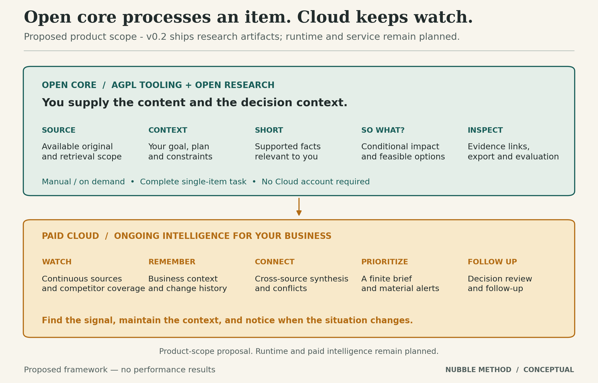

# Nubble Open Core and Nubble Cloud

**Product-boundary proposal, version 0.2, October 25, 2026.** This document selects a recommended scope for review. It does not claim that the planned core or Cloud capabilities have shipped.

> **Open source lets you nubble an article. Cloud keeps watch and tells you when something changes your situation.**

The commercial promise is ongoing intelligence for a reader's business. Team collaboration is not the primary paid feature and is deferred.

## Open core: the research method on supplied content

The target core completes a useful single-item task without requiring Nubble Cloud. A user supplies an article/document, a decision context, and a chosen model connection. The core produces Full, Short, and So what? with inspectable evidence and uncertainty. Support a local-model path before claiming a completely independent runtime; provider costs may still apply when users choose external models.

| Included in the proposed open core | Boundary |
|---|---|
| Paper, formal method, schemas, prompts, evaluation and public benchmark artifacts | Research claims must be reproducible without buying Cloud. |
| Manual rights-cleared text/file input and basic supplied-URL import | No continuous crawling, maintained source coverage, or bypass infrastructure. |
| User-supplied focus, decision, current plan, constraints and horizon | A local profile; no automatically maintained business memory. |
| Reference personalized Short and single-item So what? | No comprehensive cross-market analysis from one article. |
| Source scope, evidence links, uncertainty and five decision outcomes | Fundamental inspection and restraint mechanisms stay in core. |
| Minimal reader/CLI, local export and a model-provider interface | A usable tool without Cloud accounts or private-data sync. |
| Offline fixtures, integrity checks and reproducible evaluation | Public fixtures are separate from operational/customer data. |

Do not publish only an SDK that cannot perform the advertised core task. The complete single-item research method stays open; the commercial platform need not all be part of that core.

## Paid Cloud: ongoing intelligence for this business

| Paid capability | Concrete reason to pay |
|---|---|
| **Continuous collection and source coverage** | The reader does not have to find the article first. Monitor selected competitors, announcements and supported market sources. |
| **Maintained business and decision context** | Keep goals, plans, competitor definitions, decisions and relevant changes current and correctable over time. |
| **Change and event history** | Explain what changed since previous observations; distinguish repeated coverage from a new event. |
| **Cross-source synthesis** | Connect developments, surface contradictions and source limits, and assess their combined relevance. Disclose bounded coverage. |
| **Session-level prioritization** | Select a finite brief against the reader's attention budget and pending decisions, including what can wait. |
| **Material-change alerts** | Interrupt under declared, inspectable conditions; expose freshness and uncertainty and allow quiet periods. |
| **Decision follow-up** | Record accepted proposals and verification results, then revisit them when relevant evidence or assumptions change. |
| **Managed integrations and operations** | Maintain connectors, retrieval, storage, models, retries and run records. The fee pays for ongoing work and reliability. |

These are proposed capabilities, not current service commitments or validated performance claims. No promise to catch every material event or correctly predict business outcomes is made. Accounts/security support the service; collaboration, enterprise controls and custom deployments can follow if customers need them.

## Private assets and reproducibility

Cloud may maintain private customer context, operational source indexes, historical observations, curated coverage and independently developed services. These differ from the public benchmark needed to reproduce the paper. Third-party rights, customer consent and service terms remain applicable.

Modifications to the AGPL core must meet its applicable source/notice obligations. A Cloud-only label, separate repository, or API name alone does not establish an independent work. Review actual integration and dependencies before promising closed-source treatment of a component.

Published research claims must be reproducible from released artifacts. If a future result relies on an inaccessible Cloud ranking model or dataset, disclose it and narrow the claim or release an adequate reproduction package.

## Delivery stages

| Stage | Deliverable | Status |
|---|---|---|
| **v0.2 research release** | Paper, literature, contract, fictional examples, diagrams, protocol and authoring/validation tools. | Created here; no controlled effectiveness study. |
| **v0.3 runnable open core** | Supplied content → context → Short → So what? → inspect/export, with documented model choices. | Planned; current toolkit is not this inference engine. |
| **Cloud pilot** | Narrow monitored source set, business context, history, finite briefs and decision follow-up. | Planned; private Control Room is an implementation reference. |
| **Commercial service** | Validated customer task, documented coverage, observed operating costs, pricing and terms. | Not launched by this release. |

## Monetization reality

AGPL permits commercial use and compliant competitors. It does not reserve monetization to the original maintainer. Maintained source coverage, history, useful prioritization and reliable execution must earn the subscription.

Set pricing after observing retrieval/model/storage costs and customer willingness to pay. [LICENSE_STRATEGY.md](LICENSE_STRATEGY.md) explains the Firecrawl comparison, source obligations and future commercial-license governance.
