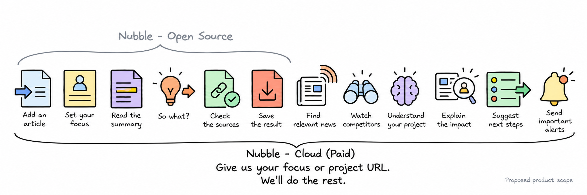

# Nubble Open Core and Nubble Cloud

**Product-boundary proposal, version 0.2, October 25, 2026.** This document selects a recommended scope for review. It does not claim that the planned core or Cloud capabilities have shipped.

> **Paid: give us your focus or project URL. We'll do the rest.**

The customer supplies either a focus in plain words or the URL of their project. Nubble does the ongoing research: finds relevant news, follows competitors where relevant, explains what changes for that project, suggests next steps, and sends important alerts. The customer does not need to find and submit each article.

## Starting with a focus or project URL

- **A focus:** describe what you want to follow, such as a project, market, research question, or decision. A company website is optional.
- **A project URL:** Nubble reads available public project pages to build an initial understanding and find relevant sources. The customer can correct that understanding or add priorities when needed.

Nubble keeps the sources, dates, previous findings and customer corrections so it can explain what changed and avoid sending the same story repeatedly. A URL does not establish private plans or goals that the site never states; missing information remains explicit. The promise covers research and proposed next steps, not automatic execution of consequential actions.

## Open core: the research method on supplied content

The target core completes a useful single-item task without requiring Nubble Cloud. A user supplies an article/document, a decision context, and a chosen model connection. The core produces Full, Short, and So what? with inspectable evidence and uncertainty. Support a local-model path before claiming a completely independent runtime; provider costs may still apply when users choose external models.

| Included in the proposed open core | Boundary |
|---|---|
| Paper, formal method, schemas, prompts, evaluation and public benchmark artifacts | Research claims must be reproducible without buying Cloud. |
| Manual rights-cleared text/file input and basic supplied-URL import | No continuous crawling, maintained source coverage, or bypass infrastructure. |
| User-supplied focus, decision, current plan, constraints and horizon | A local profile; no automatically maintained business memory. |
| Reference personalized Short and single-item So what? | No comprehensive cross-market analysis from one article. |
| Source scope, evidence links, uncertainty and five decision outcomes | Fundamental inspection and restraint mechanisms stay in core. |
| Minimal reader/CLI, local export and a model-provider interface | A usable tool without Cloud accounts or private-data sync. |
| Offline fixtures, integrity checks and reproducible evaluation | Public fixtures are separate from operational/customer data. |

Do not publish only an SDK that cannot perform the advertised core task. The complete single-item research method stays open; the commercial platform need not all be part of that core.

## Paid Cloud: we do the research for your focus

| Paid capability | Concrete reason to pay |
|---|---|
| **Find relevant news** | Search supported sources for developments related to the supplied focus; the customer does not need to bring the articles. |
| **Watch competitors** | Follow relevant competitors' announcements and explain changes to their offering, rather than only listing mentions. |
| **Understand your project** | Use the supplied focus or public project pages, retain corrections, and compare developments with the project's stated priorities. |
| **Explain the impact** | Explain why an update or several related updates could affect the project, with sources and explicit uncertainty. |
| **Suggest next steps** | Propose a feasible response, a fact to check, something to watch, or a reason to keep the current plan. |
| **Send important alerts** | Notify the customer when a declared condition is met or a meaningful change deserves attention; make the reason inspectable. |

These are proposed capabilities, not current service commitments or validated performance claims. Coverage, freshness, source conflicts and missing information remain visible. Nubble does not promise to catch every event or predict business outcomes correctly. Running the searches, sources, history, models and alerts continuously is part of the paid service.

## Private assets and reproducibility

Cloud may maintain private customer context, operational source indexes, historical observations, curated coverage and independently developed services. These differ from the public benchmark needed to reproduce the paper. Third-party rights, customer consent and service terms remain applicable.

Modifications to the AGPL core must meet its applicable source/notice obligations. A Cloud-only label, separate repository, or API name alone does not establish an independent work. Review actual integration and dependencies before promising closed-source treatment of a component.

Published research claims must be reproducible from released artifacts. If a future result relies on an inaccessible Cloud ranking model or dataset, disclose it and narrow the claim or release an adequate reproduction package.

## Delivery stages

| Stage | Deliverable | Status |
|---|---|---|
| **v0.2 research release** | Paper, literature, contract, fictional examples, diagrams, protocol and authoring/validation tools. | Created here; no controlled effectiveness study. |
| **v0.3 runnable open core** | Supplied content → context → Short → So what? → inspect/export, with documented model choices. | Planned; current toolkit is not this inference engine. |
| **Cloud pilot** | Narrow monitored source set, business context, history, finite briefs and decision follow-up. | Planned; private Control Room is an implementation reference. |
| **Commercial service** | Validated customer task, documented coverage, observed operating costs, pricing and terms. | Not launched by this release. |

## Monetization reality

AGPL permits commercial use and compliant competitors. It does not reserve monetization to the original maintainer. Maintained source coverage, history, useful prioritization and reliable execution must earn the subscription.

Set pricing after observing retrieval/model/storage costs and customer willingness to pay. [LICENSE_STRATEGY.md](LICENSE_STRATEGY.md) explains the Firecrawl comparison, source obligations and future commercial-license governance.
