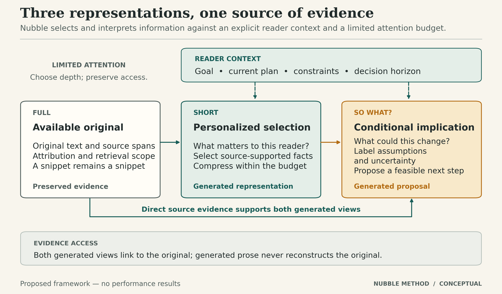
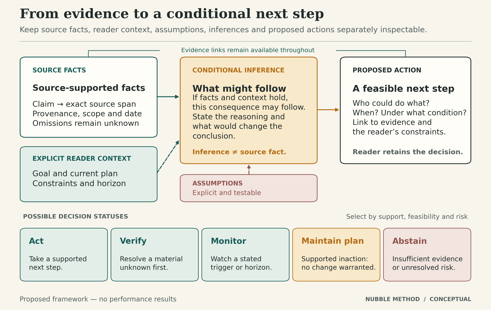
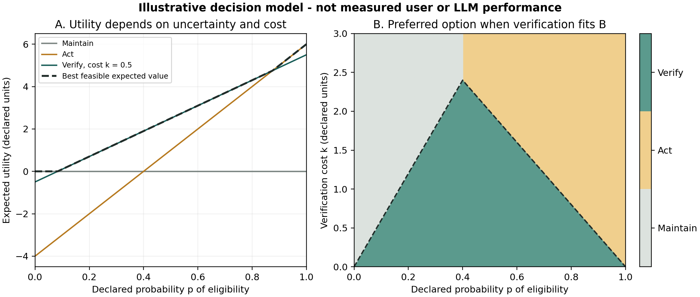
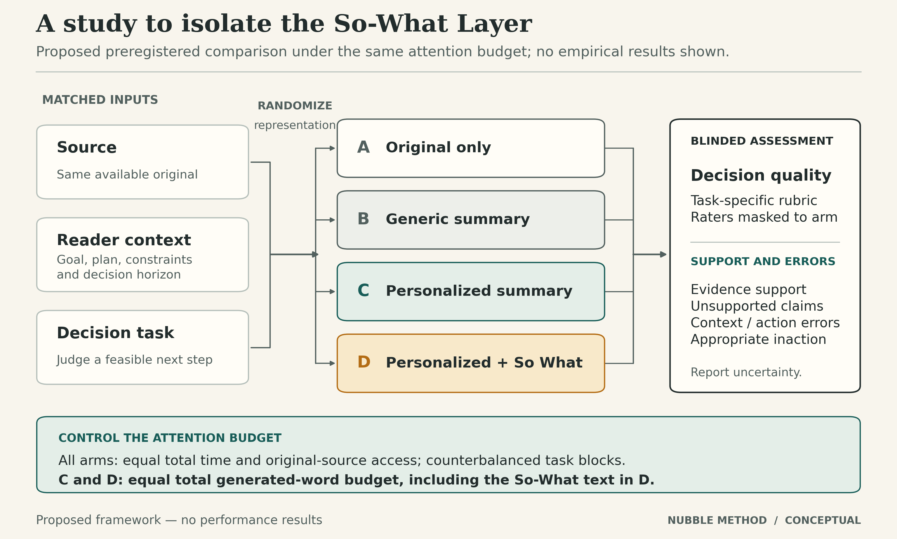

# Beyond the Summary: Nubble and the So-What Layer

## Evidence-linked, context-dependent decision support under limited attention

**Methods manuscript - Version 0.3 - October 25, 2026**

## Abstract

Readers of news and market updates must decide not only what happened, but whether a development should change a current plan. We introduce Nubble, an inspectable representation contract linking the available original, a context-conditioned summary, and a separately labeled layer of conditional implications and proposed decisions. The contract distinguishes source assertions, reader context, assumptions, implications, and feasible options, including verification, monitoring, maintaining a plan, and abstention. We characterize when a compressed representation can preserve optimal decisions and show why an additional interpretation cannot improve an ideal decision-maker with identical evidence and zero interpretation cost. A reproducible binary decision model then makes the roles of verification cost and an attention constraint explicit. A descriptive audit of 50 archived prototype records finds complete four-depth text in every record but no usable source URL, illustrating a traceability failure that text-depth controls alone do not resolve. These are analytical results and a metadata audit, not evidence of improved human or language-model performance. We provide a reference schema, examples, tests, and an evaluation design that separates source support, inferential validity, and final decision quality.

**Keywords:** personalized summarization; decision support; evidence attribution; limited attention; human-AI interaction; selective recommendation.

## 1. Introduction

A development can be easy to summarize and difficult to act on. A competitor's announcement might justify checking an overlapping capability, revising comparison copy, monitoring availability, or keeping a product plan unchanged. Its importance depends on a reader's objective, present commitments, authority, resources, and time horizon. Selecting text that resembles a reader's interests does not, by itself, explain which of these responses is justified.

Attention scarcity and decision-sensitive information display are established problems. Simon describes the attention demands of information-rich organizations, while Horvitz and Barry connect displayed information to decision value and review cost [@simon1971attention; @horvitz1995display]. Nubble adopts that tradition: attention is a constrained resource rather than an unlimited input or a universal monetary quantity. The objective is to support a feasible, evidence-sensitive decision within the time the interaction actually consumes.

We define a nubble as a linked bundle with three functional representations: **Full**, the available original and its retrieval scope; **Short**, source-supported information selected for an explicit reader context; and **So what?**, conditional implications and proposed next steps. These roles are independent of length controls. A longer generated account is not an original, a shorter account is not necessarily personalized, and an explanation of relevance is not automatically a defensible recommendation.

Decision-focused summarization and personalized implication/recommendation pipelines already exist [@hsu_tan_2021_decsum; @zhang_chen_2025_financial_cot]. Our contribution is a specific, executable contract for making their transitions inspectable, together with analytical limits and an evaluation design. We do not claim to originate personalized summaries or to have established an improvement in real decisions.

The paper contributes: (1) a typed evidence-to-decision contract with explicit feasibility, uncertainty, and restraint; (2) a decision-sufficiency criterion and an ideal-observer bound explaining what an additional representation can and cannot provide; (3) a reproducible verification-cost illustration and a descriptive audit of a pinned prototype snapshot; and (4) a study design that tests decision quality separately from persuasive prose, source support, and perceived usefulness.



**Figure 1.** Three functional representations. Original evidence and explicit context support both generated views. Full denotes what was actually available; it is never reconstructed from generated prose. The diagram specifies the method and reports no effectiveness result.

## 2. Related work

### 2.1 Decision-focused and personalized summarization

Hsu and Tan formulate decision-focused summarization, selecting sentences that preserve a downstream predictor's output while balancing representativeness and redundancy [@hsu_tan_2021_decsum]. Their decision-faithfulness objective is direct precedent for judging a summary by its downstream use. Faithfulness to a predictor, however, is different from the truth of a source claim or the appropriateness of a professional action.

PersonalSum associates personalized news summaries with reader profiles and source sentences [@zhang_etal_2024_personalsum]. SumRecom learns preferences through feedback, comparative personalization derives user representations from authored documents, and reader-aware query-focused summarization uses reconstructed answers to guide selection [@ghodratnama_zakershahrak_2024_sumrecom; @li_chaturvedi_2025_compsum; @spinoso_cheung_2024_rsa]. These approaches motivate context-sensitive selection; they do not make preference fit equivalent to decision benefit.

FRAME/SCOPE uses intermediate facts and reader-oriented questions about knowledge, goals, urgency, and relevance [@kirstein_etal_2025_frame_scope]. Information Satisfaction evaluates reader-specific informational needs and documents limitations of automatic metrics, including persona-conditioned judges [@cachola_etal_2026_information_satisfaction]. Nubble therefore uses correctable reader context and treats automatic relevance judgments as fallible proxies.

The closest action-oriented precedent is Zhang and Chen's staged financial-news framework, which connects extracted news, personalized summaries, implications, and investment recommendations [@zhang_chen_2025_financial_cot]. We cite the inspected preprint as a system precedent, not as evidence of improved investment outcomes. Nubble differs in its explicit premise types, feasible-option contract, and distinction between supported inaction and insufficient evidence. Whether these requirements improve outcomes remains empirical.

### 2.2 Evidence, human decisions, and restraint

ALCE and generative-search verifiability evaluation separate citation support from other properties of generated answers [@gao2023alce; @liu2023verifiability]. A supported statement can omit critical counterevidence or lead to an unjustified implication. Nubble consequently evaluates factual premises, conditional reasoning, and proposed decisions as distinct objects.

Human-AI decision studies show why explanation acceptance is an inadequate endpoint. Bansal and colleagues distinguish explanation effects from complementary performance; Buçinca and colleagues examine cognitive-forcing interventions and their usability tradeoffs; Vasconcelos and colleagues study verification effort and incentives [@bansal2021; @bucinca2021; @vasconcelos2023]. These findings concern their studied tasks and motivate tests here rather than guaranteeing the same effects.

Extrinsic summary evaluation measures downstream task performance and time directly [@pu_etal_2024_extrinsic]. Information-foraging models motivate tracing how readers reach useful evidence [@pirollifu2003snifact]. Selective prediction and learning-to-defer frameworks motivate reporting coverage, missed opportunities, and the costs of escalation [@geifman2019selectivenet; @mozannar2020defer]. We adapt those distinctions to natural-language decision support without treating the resulting measures as already validated.

## 3. Problem formulation

Let $D$ be the available source bundle, $c$ the reader context, and $A(c)$ a finite set of feasible decisions or conditional plans. The context includes a focus, objective, pending decision, current plan, knowledge, resources, authority, and horizon. A topic label or public project URL can help initialize $c$, but cannot establish private intentions or constraints that the reader has not supplied. Such fields retain an explicit unknown or unverified status.

Let $w$ be a task-relevant state and $U_c(a,w)$ the utility of option $a$, with action costs already incorporated and finite expected utilities. The reader's evidence-conditioned decision model defines $Q_c(a,D)$ as expected utility under the information available at decision time. This notation does not assume that a language model knows the correct probabilities or utilities. In real tasks, those quantities may be unavailable, contested, or only partially specified.

A representation policy produces a bundle $R(D,c)$. A human process $h$ may inspect it and return to $D$ before selecting an option. The design objective is:

```math
\begin{aligned}
\max_R\quad &\mathbb{E}\bigl[U_c(h(R(D,c),D,c),w)\bigr]\\
\text{subject to}\quad &h(\cdot)\in A(c),\\
&T_{\mathrm{read}}+T_{\mathrm{source}}+T_{\mathrm{verify}}+T_{\mathrm{decide}}\leq B.
\end{aligned}
```

$B$ is a declared review-time budget. Evidence inspection and verification are counted once, rather than treated as free work outside the measurement window. Context entry, delayed follow-up, generation latency, and provider costs are additionally recorded when evaluating the whole product. No exchange rate between seconds and utility is imposed without justification.

For controlled tasks with a declared decision model, regret compares the chosen option with the best option under the same permitted information. An outcome-aware oracle is a different reference and must be labeled separately. Where professional consequences cannot be identified, independently assessed reasoning/feasibility scores are appropriate, but are not observed business utility.

## 4. The Nubble representation contract

### 4.1 Full: preserve the available original

Full records stable source identity, publisher, relevant dates, retrieval method and scope, available content, version/hash, and referenceable spans. Complete text, extraction, excerpt, RSS snippet, unavailable content, and conflicting versions are distinct states. A generated expansion must never populate an original field. Preservation also does not grant redistribution rights; public examples can instead use self-authored sources or lawful retrieval manifests.

A supporting span establishes what the source states, not whether the source is true. Source credibility, factual accuracy, and publisher-to-claim support remain separate assessment questions. A URL alone does not establish any of them.

### 4.2 Short: select for a decision context

Short selects and compresses supported assertions for $c$, preserving qualifications that could change the pending decision. It may explain why an assertion was selected while keeping that contextual mapping distinct from a source observation. In the controlled comparison, forecasts about downstream effects and recommended plan changes belong to So what? Output compliance with this boundary must be checked; prompt labels alone do not enforce it.

Personalization must preserve relevant counterevidence. A watchlist match is a retrieval signal, not proof of impact. Missing source scope and low relevance must remain expressible outcomes.

### 4.3 So what?: conditional implications and feasible options

So what? links descriptive premises to possible changes in the reader's plan. Its minimum contract contains the following objects.

| Object | Required interpretation |
|---|---|
| Source assertion | A claim attributed to identified source spans; support does not imply truth. |
| Reader-context assertion | A versioned reader statement or an explicitly unverified inference about the project. |
| Assumption | A premise needed by the interpretation but not established by the available inputs. |
| Conditional implication | A possible consequence, its mechanism, dependencies, uncertainty, and reversal condition. |
| Proposed option | An action or plan with prerequisites, resource/authority requirements, and review conditions. |

The typed graph makes the transition inspectable; it does not prove the transition valid. A factual premise can support an invalid causal inference, and a plausible inference can support an infeasible action. External factual premises introduced by a model must be separately sourced or labeled as unverified, rather than attributed to the original article.



**Figure 2.** Source assertions, reader context, assumptions, implications, and proposed options have different roles. The graph documents dependencies; citation presence and graph structure are not correctness guarantees.

The contract distinguishes five outcomes. **Act** proposes a feasible change. **Verify** proposes a bounded information-gathering task. **Monitor** specifies a future trigger and a review plan. **Maintain** recommends retaining the current plan on the available evidence. **Abstain** declines to justify a recommendation because evidence or context is insufficient. Maintain can be wrong; abstention can incur missed opportunities. Verification and monitoring have costs and are not free alternatives. No proposal becomes a commitment until accepted by the reader.

### 4.4 Reference artifacts

The implementation artifacts provide a JSON schema, a self-authored source, three reader contexts, declared assumptions, and verify/maintain/abstain examples. The offline validator checks structure, references, and declared numeric/authority limits. It does not judge source truth, causal validity, or real decision benefit. Reference prompts request concise decision factors and supporting premises, not private chain-of-thought.

## 5. Analytical properties and limits

### 5.1 When is a compressed representation decision-sufficient?

Fix $c$ and a finite feasible set $A(c)$. Let $S(D,c)$ be a compressed representation and let $O(D,c)$ be the set of maximizers of $Q_c(a,D)$. Define the fiber $F(s,c)$ as the set of source bundles yielding the same representation $s$. A decoder restricted to $(s,c)$ cannot distinguish members of that fiber.

::: proposition Decision-sufficient compression

A deterministic decoder using only $S$ and $c$ can select an optimal option for every $D$ in a fiber if and only if the optimal-option sets in that fiber have a nonempty intersection:

```math
\bigcap_{D\in F(s,c)} O(D,c)\neq\varnothing.
```

:::

::: proof

If such a decoder exists, it returns the same option for every $D$ in the fiber. That option must belong to every $O(D,c)$, so the intersection is nonempty. Conversely, selecting any element of a nonempty intersection is optimal for every member of the fiber. For a randomized decoder to achieve zero expected regret for every member, its support must likewise be contained in the intersection.

:::

This is an elementary specialization of decision sufficiency to representation design, not a new general decision-theory theorem. It gives a concrete failure test: an omission can preserve topic or textual similarity while destroying the common optimal decision. For example, two available originals may distinguish a broadly available release from an existing-customer pilot. If Short reduces both to the same launch announcement, a reader who lacks pilot eligibility may require different responses. The original distinction must be recoverable.

The proposition concerns a decoder restricted to Short. It does not imply inevitable loss when the interface permits timely return to Full. That interaction is precisely why source-access effort belongs in the budget.

### 5.2 What can an additional interpretation contribute?

::: proposition Ideal-observer bound

Suppose an observer already has $D$ and $c$, the same decision model and feasible options, unlimited computation, and zero interpretation cost. Adding a deterministic implication representation $I=f(D,c)$ cannot increase its optimal expected utility.

:::

::: proof

The observer can compute $f$ from its existing inputs and emulate any decision rule based on the augmented representation. The augmented input therefore supplies no decision capability unavailable under the assumptions. Conversely, the observer can ignore $I$. The attainable optimum is unchanged.

:::

Nubble's practical hypothesis concerns finite human attention, computation, and verification effort; it does not create information by renaming a representation. If the implication step retrieves new evidence or supplies expertise unavailable to the reader, that change must be stated and controlled. An empirical comparison should not attribute an advantage from additional evidence, more words, or a stronger model to the So-What format alone.

### 5.3 Operational restraint under partial knowledge

An expected-utility recommendation requires a defensible decision model. If several models remain plausible, a robust recommendation can be defined as an option optimal across all of them. An empty intersection is a reason to seek information or abstain, not to declare that maintaining the plan is optimal. This parallels the representation criterion while distinguishing epistemic uncertainty from a substantive choice. Monitor and verify are conditional plans whose feasibility and costs also need specification.

## 6. Reproducible computational illustration

Consider a fictional integration decision. Eligibility is unknown; a feasible change yields gain 6 if eligible and loss 4 otherwise. Maintaining has utility zero. These are declared arbitrary task units, not money or measured effects. Let $p$ be a supplied probability of eligibility, and suppose a check perfectly reveals eligibility at cost $k$, after which the reader can choose whether to change. This idealized check bounds what useful verification could provide; real checks may be noisy or unable to resolve future consequences.

The expected values are:

```math
V_{\mathrm{maintain}}=0,\qquad
V_{\mathrm{act}}=6p-4(1-p)=10p-4,\qquad
V_{\mathrm{verify}}=6p-k.
```

Without verification, act is preferable when $p$ exceeds 0.4. Verification improves on both alternatives exactly when it fits the remaining attention/resources and:

```math
k<\min\{6p,4(1-p)\}.
```

For $k=0.5$ this is the interval $1/12<p<7/8$. The maximum gross value of perfect information is 2.4 at $p=0.4$. At $p=0.3$, act has value -1, maintain 0, and verification 1.3. At $p=0.1$ and $k=0.8$, maintain is preferable; at $p=0.9$ and $k=0.8$, act is preferable. If the check cannot fit the review budget, its utility is not an available option.



**Figure 3.** Calculated values and preferred options under the explicitly hypothetical model. Panel A fixes $k$ at 0.5; panel B varies it. Verification is assumed feasible in time in panel B, and ties favor the less demanding alternative. These curves are not Nubble-versus-baseline measurements, estimates of reader behavior, or calibrated model confidence.

The script enumerates the declared probabilities/costs and exports the numerical inputs and outputs. Tests verify the boundary inequalities, nonnegative gross information value, feasibility exclusion, and the representation-collision example. A computational check supports these calculations only; it does not establish empirical effectiveness.

## 7. Descriptive audit of archived prototype metadata

A pinned public repository snapshot provides a small implementation case study. We inspected all five archived feed snapshots at revision [d1a3f84a91c1](https://github.com/xclv-ai/nubble-me/tree/d1a3f84a91c1616f0bdb9935f97b5c7ef7071f7a). The manifest records their full paths and revision. Each contains ten story records. A record counted as having four depths only if every section contained nonempty summary, condensed, standard, and expanded strings. A usable source URL required an HTTP(S) scheme and hostname; no network retrieval or factuality judgment was performed.

| Feed category | Snapshot date | Records | Four depths | Usable source URLs |
|---|---|---|---|---|
| a16z-portfolio | 2026-05-11 | 10 | 10 | 0 |
| ai-branding | 2026-05-11 | 10 | 10 | 0 |
| ai-ecommerce | 2026-05-11 | 10 | 10 | 0 |
| ai-news | 2026-05-11 | 10 | 10 | 0 |
| pokpok-personalized | 2026-04-08 | 10 | 10 | 0 |
| Total | Archived snapshots | 50 | 50 | 0 |

All 50 records expose four textual depths, while all 50 have an unusable source URL field. This establishes a particular metadata traceability failure, not that their textual claims are false or that no source existed upstream. It illustrates why a depth interface is insufficient to establish Full in the proposed contract. Notebook identifiers and source counts do not recover claim-to-source links in these distributed records.

The inputs are convenience-selected archived product snapshots, not a representative sample of news systems. Their dates are historical, and records are not independent experimental units supporting an efficacy claim. The audit exports category counts, exact paths, and SHA-256 input hashes. No private dashboard content, source article copies, or unpublished customer information is included.

The separate reader/Control Room prototypes motivate the interaction pattern, but are not measured here. Their presence does not establish the contract's full implementation or its effects.

## 8. Evaluation of the human-facing hypothesis

The analytical and metadata results leave a practical question open: does the representation help people choose better within limited attention? A prospective comparison should distinguish original-only access (A), a generic supported summary (B), personalized Short (C), and personalized Short plus explicit implications/options (D). All arms receive the same task, reader-role brief, and original-source access. Generated arms share model/source access and total display budgets; the primary D-C contrast shares context, evidence navigation, neutral style, and uncertainty conventions.



**Figure 4.** A prospective human experiment. The diagram is a study design, not a completed result. Source verification remains inside elapsed review time; D's implications must fit the same total generated-word budget as C.

Use controlled cases with declared utilities/reference policies and realistic professional tasks with blinded ordinal rubrics as distinct tracks. Randomize and counterbalance case/condition assignment; a participant must not see the same case in multiple forms. Freeze prompts, model versions, artifacts, payoff rules, timeouts, exclusions, missing-data handling, and stopping rules. Pilot difficulty and variance, then determine sample size from a declared minimum useful effect and an analysis accounting for participant/case clustering.

The primary controlled-track estimand is the intention-to-treat D-C difference in final case-defined utility at common $B$, with uncertainty and sensitivity to justified payoff weights. Under a common case reference, the regret difference is the sign-reversed presentation of that contrast. Realistic rubric scores are analyzed separately. Personalized-summary and staged-prompt sensitivity baselines should test whether an artificially constrained C or extra prompting explains an advantage.

Secondary outcomes include critical evidence comprehension, unsupported premises, omitted counterevidence, inferential validity, hard-constraint violations, inappropriate action, false reassurance, missed beneficial action, verification success and time, and workload. The atomic-claim rubric adapts citation-evaluation concepts; it is not identical to ALCE's or Liu and colleagues' metrics. Automatic judges require held-out human calibration.

Report recommendation coverage and risk together, with act/verify/monitor/maintain declared separately from abstention. Count the costs of deferral and missed opportunities. Run an AI-only policy on the same case distribution before claiming human-AI complementarity. A separate stress stratum can test plausible erroneous advice; its imposed error prevalence is not a product error-rate estimate. None of these human or LLM experiments is reported as completed in this paper.

## 9. Limitations, ethics, and transparency

The contract makes claims inspectable without guaranteeing their truth. Public project pages may misdescribe current capabilities, reader context may be incomplete, sources may be unreliable or stale, and implications may depend on unverified causal mechanisms. A source association is not a causal effect of an action. Persuasive explanations may increase inappropriate reliance, and personalization may suppress unfamiliar but important developments.

The formal observations assume finite, specified feasible options and a declared decision model. The numerical illustration assumes known probabilities, arbitrary payoffs, and perfect verification. Those assumptions do not hold automatically in professional work. Elapsed review time is an imperfect proxy for attention: cognitive effort and switching costs may differ within the same time budget. The audit concerns five old snapshots from one prototype and cannot establish the prevalence of provenance failures elsewhere. The focused literature review is non-exhaustive and includes preprints and partial reads; its version/access ledger is public.

No human participants were recruited and no behavioral outcomes were collected for the reported calculations or metadata audit. Source assertions, private strategy, and customer documents need appropriate access, retention, and redistribution controls in a deployed system. Instructions embedded in source content are data, not authority. Recommended consequential actions remain proposals for human decision-making.

Nubble is under development as a product. This manuscript reports a representation contract, analytical observations, computational illustrations, and a descriptive audit; it makes no commercial-performance or independent-validation claim. Commercial packaging and promotional graphics are outside the scientific argument.

**Use of generative AI.** OpenAI Codex was used substantially for drafting, literature organization, mathematical exposition, code, and figure preparation. The cited source records, assumptions, calculations, and scripts are made inspectable. Generative AI is not an author. Named authors remain responsible for the manuscript's contents and must complete their review before submission.

## 10. Conclusion

Nubble separates source access, context-sensitive compression, and conditional implications as three linked functions. Its contract requires explicit premises, feasible options, and a distinction between maintaining a plan and declining to justify a recommendation. The analytical results explain how compression can lose decision-relevant distinctions and why an interpretation offers no automatic benefit to an ideal observer. The computational example and archived-metadata audit make those concerns concrete without supplying behavioral evidence. The remaining claim is empirical: any benefit must arise through a measured improvement in the reader's decision process, within the attention the system consumes.

## Appendix A. A fictional source across reader contexts

The public fixture describes a fictional vendor piloting weekly AI brand-mention reports. Its announcement gives no standalone price and does not discuss human-versus-AI brand-perception comparison. The source is self-authored and marked fictional.

| Reader decision | Relevant missing or supported premise | Intended outcome |
|---|---|---|
| Whether to revise comparison copy | Actual feature overlap and buyer relevance need checking; research authority is limited to 30 minutes. | Verify a bounded fact; do not change the roadmap on this evidence. |
| Which keyboard-navigation bugs to fix | The announcement identifies no relevant change to the stated accessibility sprint. | Maintain the current regression list. |
| Whether buying improves conversion at an affordable price | Price, outcome evidence, and procurement authority are absent. | Abstain from a purchase-value recommendation. |

The same source assertions remain stable while reader premises differ. The examples do not establish real vendor capabilities or model performance. Silence about a feature does not establish its absence. The schema and tests reject dangling evidence, unknown contexts, declared authority/resource violations, and incompatible restraint fields; semantic evaluation remains a separate task.

## Appendix B. Reproducibility

The [public research toolkit](https://github.com/xclv-ai/nubble-me/tree/main/GPT%20Nubble) supplies the analytical script, numerical outputs, snapshot manifest, typed fixture, schema, reference prompts, and study protocol in the version 0.3 research export. The analysis script reproduces the hypothetical model without API calls. The optional audit command reads the five public JSON files from the pinned Git revision and publishes only metadata/counts/hashes. Figure generation uses Matplotlib 3.10.9; the source package uses standard LaTeX packages and a fixed date. Software is licensed AGPL-3.0-only and original research text/figures are CC BY 4.0; cited works retain their respective terms.

The submission source includes only manuscript inputs, bibliography, and referenced scientific figures. Promotional assets, private implementation notes, caches, credentials, and repository history are excluded. Exact author and affiliation metadata must be supplied by the authors; no identity, DOI, acceptance, or peer-review status is inferred.

<!-- GENERATED-REFERENCES -->

## References

1. Chao-Chun Hsu, Chenhao Tan. 2021. **Decision-Focused Summarization**. Proceedings of EMNLP 2021. [Canonical record](https://aclanthology.org/2021.emnlp-main.10/).

2. Lemei Zhang, Peng Liu, Marcus Tiedemann Oekland Henriksboe, Even W. Lauvrak, Jon Atle Gulla, Heri Ramampiaro. 2024. **PersonalSum: A User-Subjective Guided Personalized Summarization Dataset for Large Language Models**. Advances in Neural Information Processing Systems 37, Datasets and Benchmarks. [Canonical record](https://proceedings.neurips.cc/paper_files/paper/2024/hash/b3c318cd7ee132d8a6b1895a2d6436c7-Abstract-Datasets_and_Benchmarks_Track.html).

3. Samira Ghodratnama, Mehrdad Zakershahrak. 2024. **SumRecom: A Personalized Summarization Approach by Learning from Users' Feedback**. arXiv. [Canonical record](https://arxiv.org/abs/2408.07294).

4. Cesare Spinoso-Di Piano, Jackie Chi Kit Cheung. 2024. **Does This Summary Answer My Question? Modeling Query-Focused Summary Readers with Rational Speech Acts**. arXiv. [Canonical record](https://arxiv.org/abs/2411.06524).

5. Tianyi Zhang, Mu Chen. 2025. **Personalized Chain-of-Thought Summarization of Financial News for Investor Decision Support**. arXiv; author comments state Proceedings of ICDM Workshops. [Canonical record](https://arxiv.org/abs/2511.05508).

6. Haoyuan Li, Snigdha Chaturvedi. 2025. **Comparative Personalization for Multi-document Summarization**. arXiv. [Canonical record](https://arxiv.org/abs/2509.21562).

7. Xiao Pu, Mingqi Gao, Xiaojun Wan. 2024. **Is Summary Useful or Not? An Extrinsic Human Evaluation of Text Summaries on Downstream Tasks**. LREC-COLING 2024. [Canonical record](https://aclanthology.org/2024.lrec-main.821/).

8. Frederic Kirstein, Sonu Kumar, Terry Ruas, Bela Gipp. 2025. **Re-FRAME the Meeting Summarization SCOPE: Fact-Based Summarization and Personalization via Questions**. Findings of the Association for Computational Linguistics: EMNLP 2025. [Canonical record](https://aclanthology.org/2025.findings-emnlp.1094/).

9. Isabel Cachola, William Walden, Reno Kriz, Mark Dredze. 2026. **Information Satisfaction: A Reader-Centered Axis for Summarization Evaluation**. ACM publication linked by DOI; exact conference name not established from inspected metadata. [Canonical record](https://dl.acm.org/doi/10.1145/3834580.3838749).

10. Gagan Bansal, Tongshuang Wu, Joyce Zhou, Raymond Fok, Besmira Nushi, Ece Kamar, Marco Tulio Ribeiro, Daniel S. Weld. 2021. **Does the Whole Exceed its Parts? The Effect of AI Explanations on Complementary Team Performance**. Proceedings of the 2021 CHI Conference on Human Factors in Computing Systems. [Canonical record](https://doi.org/10.1145/3411764.3445717).

11. Zana Buçinca, Maja Barbara Malaya, Krzysztof Z. Gajos. 2021. **To Trust or to Think: Cognitive Forcing Functions Can Reduce Overreliance on AI in AI-assisted Decision-making**. Proceedings of the ACM on Human-Computer Interaction 5, CSCW1, Article 188. [Canonical record](https://doi.org/10.1145/3449287).

12. Helena Vasconcelos, Matthew Jörke, Madeleine Grunde-McLaughlin, Tobias Gerstenberg, Michael Bernstein, Ranjay Krishna. 2023. **Explanations Can Reduce Overreliance on AI Systems During Decision-Making**. Proceedings of the ACM on Human-Computer Interaction 7, CSCW1, Article 129. [Canonical record](https://doi.org/10.1145/3579605).

13. Tianyu Gao, Howard Yen, Jiatong Yu, Danqi Chen. 2023. **Enabling Large Language Models to Generate Text with Citations**. Proceedings of the 2023 Conference on Empirical Methods in Natural Language Processing. [Canonical record](https://aclanthology.org/2023.emnlp-main.398/).

14. Nelson F. Liu, Tianyi Zhang, Percy Liang. 2023. **Evaluating Verifiability in Generative Search Engines**. Findings of the Association for Computational Linguistics: EMNLP 2023. [Canonical record](https://aclanthology.org/2023.findings-emnlp.467/).

15. Yonatan Geifman, Ran El-Yaniv. 2019. **SelectiveNet: A Deep Neural Network with an Integrated Reject Option**. Proceedings of the 36th International Conference on Machine Learning, PMLR 97. [Canonical record](https://proceedings.mlr.press/v97/geifman19a.html).

16. Hussein Mozannar, David Sontag. 2020. **Consistent Estimators for Learning to Defer to an Expert**. Proceedings of the 37th International Conference on Machine Learning, PMLR 119. [Canonical record](https://proceedings.mlr.press/v119/mozannar20b.html).

17. Peter Pirolli, Wai-Tat Fu. 2003. **SNIF-ACT: A Model of Information Foraging on the World Wide Web**. User Modeling 2003, UM 2003, Lecture Notes in Computer Science 2702. [Canonical record](https://link.springer.com/chapter/10.1007/3-540-44963-9_8).

18. Herbert A. Simon. 1971. **Designing Organizations for an Information-Rich World**. Archival manuscript, Carnegie Mellon University; chapter associated with Computers, Communications, and the Public Interest. [Canonical record](https://iiif.library.cmu.edu/file/Simon_box00055_fld04178_bdl0002_doc0001/Simon_box00055_fld04178_bdl0002_doc0001.pdf).

19. Eric J. Horvitz, Matthew Barry. 1995. **Display of Information for Time-Critical Decision Making**. Proceedings of the Eleventh Conference on Uncertainty in Artificial Intelligence. [Canonical record](https://arxiv.org/abs/1302.4959).
